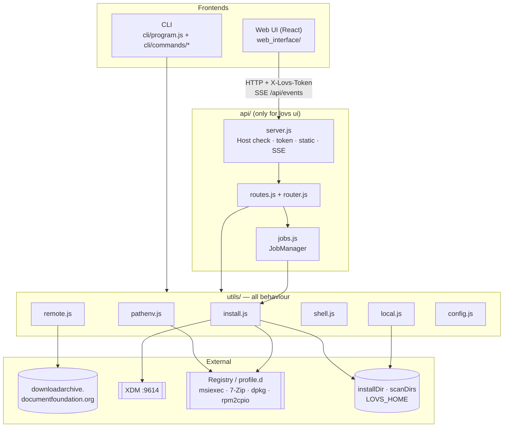
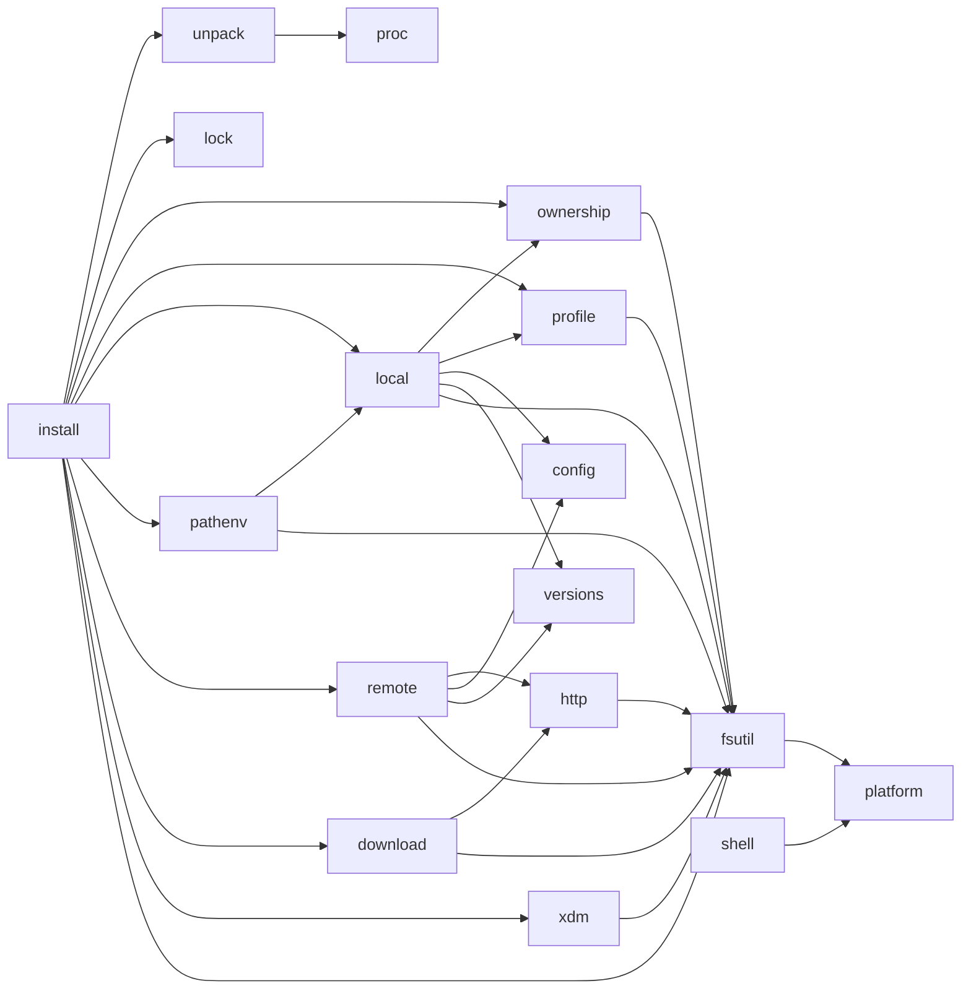
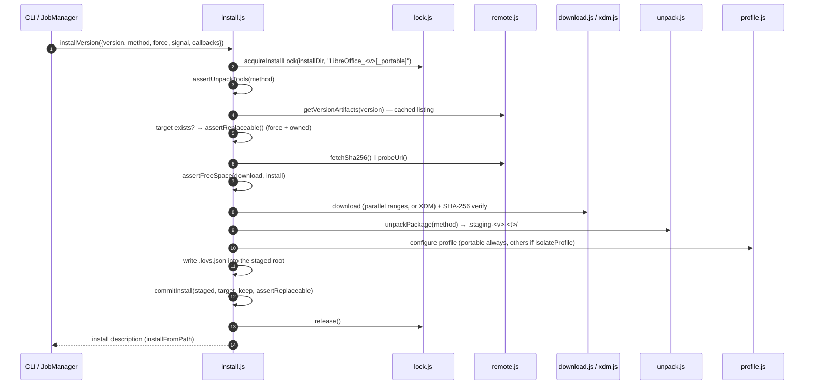
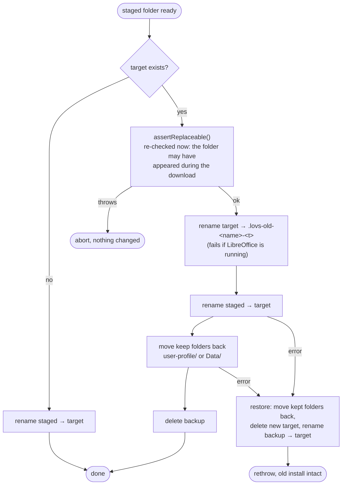
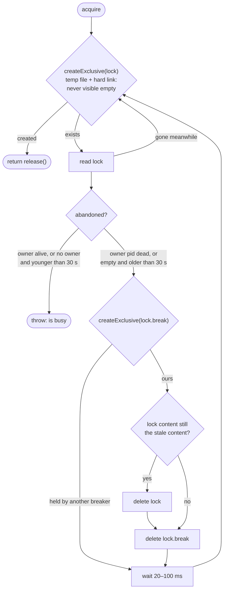
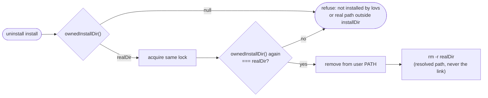
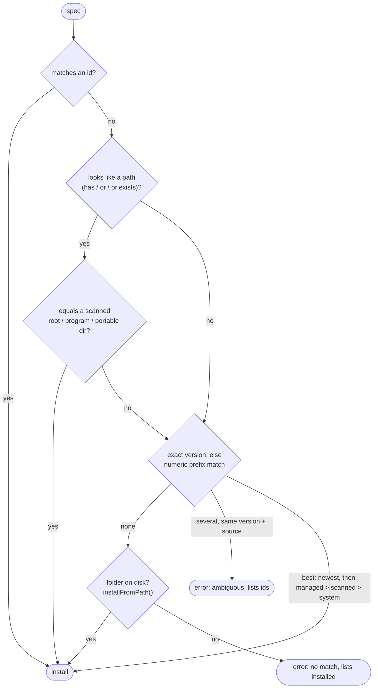
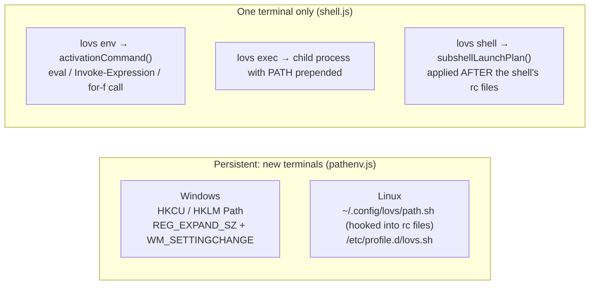
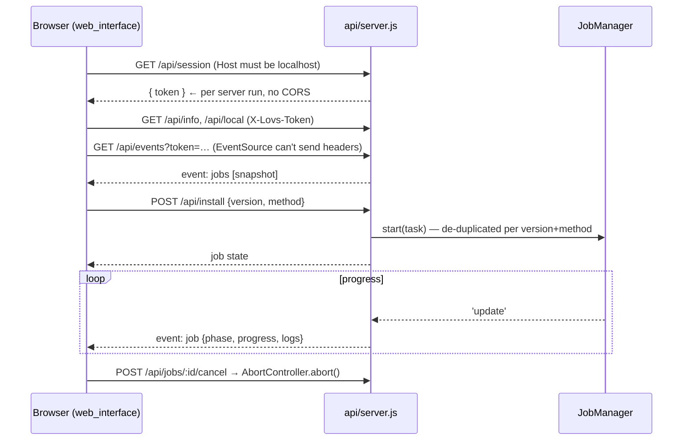
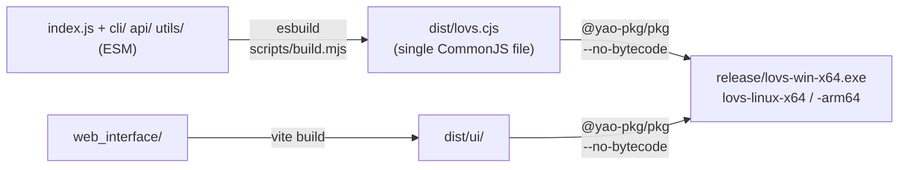

# lovs — developer notes

How `libreoffice-version-switcher` is built, why it is built that way, and how to change it safely.
User-facing documentation lives in [README.md](README.md).

- [1. Principles](#1-principles)
- [2. Getting started](#2-getting-started)
- [3. Repository map](#3-repository-map)
- [4. Architecture](#4-architecture)
- [5. Core flows](#5-core-flows)
- [6. Data on disk](#6-data-on-disk)
- [7. Security model](#7-security-model)
- [8. Conventions](#8-conventions)
- [9. Testing](#9-testing)
- [10. Build and packaging](#10-build-and-packaging)
- [11. How to…](#11-how-to)
- [12. Platform gotchas](#12-platform-gotchas)
- [13. Known limitations](#13-known-limitations)

---

## 1. Principles

1. **Never register anything with the OS.** Every version is an unpacked folder (MSI admin extract, 7-Zip'd portable, extracted deb/rpm). That is what lets any number of versions coexist without admin or root.
2. **Only delete what lovs created.** Ownership needs a `.lovs.json` marker *and* a real (links resolved) location directly inside `installDir`. Scan folders and system installs are read-only.
3. **Replace, never destroy.** Reinstalls are staged, verified and configured first, then swapped in, keeping the profile and rolling back on failure.
4. **One core, two front ends.** `utils/` holds all behaviour. `cli/` and `api/` are thin adapters, so the CLI and the web UI cannot drift apart.
5. **Generated commands must be literal.** Every path pasted into a shell is quoted for that specific shell. Anything that can't be quoted safely is refused, never approximated.

## 2. Getting started

```sh
npm install
npm run dev        # API on :5178 (restarts on change) + Vite on :5173 (opens the browser)
npm test           # vitest, ~10 s; includes real bash / PowerShell / cmd checks where available
npm run build      # web UI -> dist/ui, CLI + API bundle -> dist/lovs.cjs
npm run pkg        # standalone executables -> release/
node index.js ls   # run the CLI from source
```

Point `LOVS_HOME` at a scratch folder while developing, so your real config, cache and installs stay untouched:

```sh
LOVS_HOME=/tmp/lovs-dev node index.js install 7.6 --method portable
```

Requirements: Node ≥ 22.12. Windows needs PowerShell 5.1+ (always present); 7-Zip is optional. Linux needs `tar`, plus `dpkg-deb` or `rpm2cpio` + `cpio`.

## 3. Repository map

```
index.js                 CLI entry point -> cli/program.js
cli/
  program.js             commander definitions only (no logic)
  commands/              one module per command area
    installed.js           list, uninstall
    archive.js             remote, remote info, install
    path.js                path status|add|remove, which
    session.js             env, exec, shell
    settings.js            config list|get|set|add-scan-dir|remove-scan-dir
    doctor.js              doctor
  hints.js               copy-paste follow-up commands
  output.js              messages, tables, progress bar, formatting
api/
  server.js              HTTP server: security checks, static UI, SSE, error boundary
  router.js              HttpError + ":param" route matching
  routes.js              the JSON API route table
  jobs.js                background jobs (installs) with progress and cancel
utils/                   all behaviour; no knowledge of CLI or HTTP
  install.js             install / uninstall orchestration, commit + rollback
  unpack.js              per-method unpackers (msi, portable, deb, rpm)
  lock.js                cross-process install lock
  ownership.js           .lovs.json marker and "does lovs own this folder?"
  profile.js             UserInstallation (per-version user profile)
  local.js               scan for installs, describe them, resolve a selector
  remote.js              archive listings and package lookup (cached)
  download.js            built-in parallel downloader
  xdm.js                 Xtreme Download Manager integration
  pathenv.js             persistent PATH (registry / profile.d)
  shell.js               per-session activation, quoting, sub-shell launch plans
  config.js              settings schema, load/validate/save
  platform.js            OS / arch / distro detection
  versions.js            version parsing, sorting, matching
  fsutil.js              shared filesystem helpers
  http.js proc.js        fetch with timeout/retry; child processes
web_interface/           React 19 + Vite UI (built into dist/ui)
  src/App.jsx            tab shell
  src/api.js             token-aware fetch + SSE subscription
  src/hooks/             data hooks (useServerInfo, useLocalInstalls, useJobs, …)
  src/lib/               pure helpers (format, versions, clipboard, …)
  src/components/<area>/ installed, available, activity, settings, layout, ui
scripts/                 build.mjs (esbuild bundle), dev.mjs (dev runner)
test/                    vitest suites (see §9)
```

## 4. Architecture

### 4.1 Layers



`cli/` and `api/` only translate. They parse input, call `utils/`, and format the output for a terminal or as JSON. Anything a user can do in one front end must therefore be a `utils/` function the other can call.

### 4.2 Core module dependencies

Arrows point from the importer to what it imports. The graph is acyclic; keep it that way.



## 5. Core flows

### 5.1 Install

`installVersion()` in [utils/install.js](utils/install.js). The lock is held for the whole run.



Phases reported through `onPhase` are `resolve → download → verify → extract → configure → done`. The web UI shows them as the step pills in Activity.

### 5.2 Commit and rollback

`commitInstall()` is the only place an existing install is replaced:



The backup name starts with a dot, so a scan never lists it as an install, even if a crash leaves it behind.

### 5.3 Install lock

[utils/lock.js](utils/lock.js), shared by install and uninstall, across processes (CLI and web UI):



`release()` deletes the lock only while it still holds this process's own random token. `test/lock-race.test.js` starts 8 processes at once, against both a free lock and a stale one, and requires exactly one winner.

### 5.4 Uninstall safety



`ownedInstallDir(root, installDir)` returns the real top folder only when all of these hold:
- `root/.lovs.json` exists and is valid;
- `realpath(top)` is a **direct child** of `realpath(installDir)`;
- `realpath(root)` is inside it.

Junctions and symlinks therefore can't redirect a delete.

### 5.5 Resolving what the user typed

[utils/local.js](utils/local.js) turns `7.6`, `aced11a18c` or `D:\Portable\LO_7.6` into one install:



Going the other way, `selectorFor(install, installs)` produces the argument that resolves back to exactly that install: the version if unambiguous, else the id if the scan finds it, else the absolute folder. `cli/hints.js` quotes it for the current shell. Without this round trip, the hints printed after `install` or `path add` could point at the wrong copy, or at nothing.

### 5.6 Activating a version: persistent vs. session



On Windows a new shell's PATH is **machine + user**, so a LibreOffice folder in the machine PATH hides any user entry. `getPathStatus().newShells` models that order, and both front ends warn about it.

`lovs shell` must apply the version *after* the startup files. Otherwise lovs' own rc hook re-prepends the persistent default ahead of it. Each shell gets a different mechanism:
- bash: `--rcfile`
- zsh: a temporary `ZDOTDIR`
- fish: `--init-command`
- PowerShell: `-NoExit -Command`
- cmd: `/K`

### 5.7 Web UI ↔ server



On a `401` the client fetches a new token once and retries, which covers a restarted server. The SSE stream reconnects every 2 s and fetches a fresh token on reconnect.

## 6. Data on disk

### 6.1 `LOVS_HOME` (default `~/.lovs`)

```
config.json                     settings (CONFIG_SCHEMA in utils/config.js)
cache/remote-versions.json      archive version list (6 h)
cache/artifacts/<v>-<os>-<arch>.json   packages per version (empty results: 24 h)
cache/probed-versions.json      `soffice --version` results keyed by root + soffice mtime
versions/                       default installDir
downloads/                      default downloadDir
```

### 6.2 `installDir`

```
LibreOffice_25.2.7.2/                 msi / deb / rpm
  .lovs.json                          ownership marker
  program/  share/  …
  user-profile/                       isolated profile (UserInstallation=$ORIGIN/../user-profile)
LibreOffice_7.6.7.2_portable/         portable
  App/libreoffice/.lovs.json          marker lives at the LibreOffice root
  App/libreoffice/program/…
  Data/settings/                      profile (UserInstallation=$ORIGIN/../../../Data/settings)
  LibreOffice*Portable.exe            PortableApps launchers
.lovs-lock-<folder>                   install lock {pid, token, at}
.lovs-lock-<folder>.break             short-lived stale-lock breaker
.staging-<version>-<time>/            unpack area (removed afterwards)
.lovs-old-<folder>-<time>/            backup during a reinstall (removed afterwards)
```

Every lovs-internal entry starts with `.`, and the scanner skips dot entries.

### 6.3 `.lovs.json`

```json
{
  "version": "25.2.7.2",
  "method": "msi",
  "fileName": "LibreOffice_25.2.7.2_Win_x86-64.msi",
  "url": "https://downloadarchive.documentfoundation.org/…",
  "sha256": "9fdd22f8…",
  "downloader": "builtin",
  "isolatedProfile": true,
  "installedAt": "2026-10-02T06:12:18.665Z"
}
```

`readMetadata()` accepts it only when `version` and `method` are strings. The `isolatedProfile` shown in the UI is **always read from the real bootstrap file**, never from this record.

## 7. Security model

The web server can edit PATH and run installers, so:

| Threat | Mitigation | Where |
| --- | --- | --- |
| Another machine calls the API | Binds to `127.0.0.1` by default | `startServer` |
| A website in the browser calls the API (CSRF) | Every `/api/*` call needs `X-Lovs-Token`; the token comes from `/api/session`, which other origins can't read (no CORS) | `handleApi` |
| DNS rebinding (`evil.com` → 127.0.0.1) | `Host` must be loopback on our port. With `--host 0.0.0.0` this machine's own addresses and hostname are added, never arbitrary names | `allowedHosts` |
| Malformed URLs crash the process | One error boundary around every request; bad encodings → 400 | `server.js`, `router.js` |
| Path traversal in static files | `path.relative` containment check, SPA fallback | `serveStatic` |
| Deleting a user's folders | Ownership marker + real-path direct-child check, re-checked under the lock | `ownership.js`, `install.js` |
| Shell injection via pasted commands | Per-shell literal quoting; cmd refuses `% ^ ! "` | `shell.js` |
| Tampered downloads | SHA-256 from the archive, checked for both downloaders | `download.js`, `install.js` |

## 8. Conventions

**Code**
- ESM everywhere (`"type": "module"`), Node built-ins imported as `node:*`.
- Each file starts with a short header saying what it is for. Comments explain *why* (platform quirks, invariants), not *what*.
- Descriptive names: `install` (not `inst`), `artifact`, `stagingDir`, `downloaderName`. Single letters only in tiny lambdas.
- Named constants for magic numbers (`GRACE_MS`, `SEGMENTED_MIN_BYTES`, `UNPACK_SPACE_FACTOR`).
- Pure, synchronous helpers where possible (`withEntryAdded`, `selectorFor`, `subshellLaunchPlan`). They are what the tests exercise.

**Errors**
- Throw `Error` with a message a user can act on ("… Use --force to reinstall.").
- Cancellation surfaces as `name: 'AbortError'`. Long operations take an `AbortSignal` and call `signal.throwIfAborted()` between steps; `runCommand()` refuses to start once aborted.
- HTTP handlers throw `HttpError(status, message)`; anything else becomes a 500 and is logged.

**Cross-platform**
- Compare paths with `normalizePath` / `isInside` / `samePath` (case-insensitive on Windows).
- Use `realPath()` wherever a decision could be fooled by a link.
- Use `isWindows` from `platform.js`; never sniff `process.platform` elsewhere.
- Spawn with argument arrays. `verbatim: true` exists only for msiexec and NSIS, which parse their own command lines.

**Front ends**
- CLI handlers live in `cli/commands/<area>.js` and are wrapped by `action()` in `program.js`, which prints errors and sets the exit code.
- The HTTP contract (paths, JSON fields, SSE events) is what the UI depends on. Change both sides together.

## 9. Testing

`npm test` runs every suite in `test/`. Suites that need a real shell skip themselves when it isn't available.

| Suite | Covers |
| --- | --- |
| `versions.test.js` | parse, sort (pre-releases), prefix matching, "latest" |
| `remote.test.js` | archive directory-listing parser |
| `local.test.js` | scanning, version sources, prefix resolution |
| `pathenv.test.js` | PATH entry add/remove, Linux path-file round trip |
| `shell.test.js` | activation commands per shell |
| `shellarg.test.js` | literal quoting in **real** bash and PowerShell; cmd one-liner keeps PATH (real cmd) |
| `subshell.test.js` | launch plans; real bash with a PATH-prepending `.bashrc` |
| `hints.test.js` | selector round trips; generated bash hint for an external folder, run in real bash |
| `safety.test.js` | ownership, junction escapes, commit/rollback, profile isolation, cancellation, lock basics, server 400 |
| `reinstall.test.js` | `--force` never touches the old install when lovs doesn't own it or the download fails (mocked network) |
| `lock-race.test.js` | 8 processes racing for a free and a stale lock: exactly one winner |
| `download.test.js` | parallel range download + SHA-256 against a local server; a failing piece stops every other connection |
| `server-hosts.test.js` | Host allow-list for loopback and wildcard binds; rebinding names refused |
| `fsutil.test.js` | path normalisation and containment, including filesystem roots |

Guidelines:
- Every bug fix gets a regression test that fails on the old code.
- Use temporary folders and set `process.env.LOVS_HOME` in the test file. Never touch the developer's real config, PATH or installs.
- Fake installs need only `program/soffice(.exe)` plus a marker file (see `fakeInstall()` in the suites).
- Prefer running the real shell over asserting on strings when quoting is involved.

## 10. Build and packaging



- **Why a CJS bundle:** pkg handles CommonJS far more reliably than ESM. `import.meta.url` doesn't exist in CJS, so `build.mjs` defines it from `__filename`; that is how `server.js` finds `dist/ui` next to the bundle, including inside the pkg snapshot.
- **Why `--no-bytecode`:** bytecode needs the target's Node binary to run during the build, which makes cross-compiling impossible (linux-arm64 from Windows fails with `spawn UNKNOWN`).
- `PKG_CACHE_PATH` moves pkg's Node binary cache, which is useful when the system drive is full.
- The Linux binaries need glibc 2.28+ (RHEL/Oracle Linux 8+, Ubuntu 20.04+).

## 11. How to…

**Add a CLI command**
1. Write the handler in the matching `cli/commands/<area>.js` (or a new area module). Use `loadConfig()`, call `utils/`, and print with `cli/output.js`.
2. Register it in `cli/program.js` inside the right `add…Commands()` function, wrapped in `action()`.
3. Document it in the README's CLI table.

**Add an API route**
1. Add a `[method, '/api/…', handler]` entry in `api/routes.js`. Keep the handler small; put real logic in `utils/`.
2. Validate input with the `require…()` helpers and throw `HttpError(400, …)` for bad input.
3. Call it from `web_interface/src` through `api()` (it adds the token).

**Add a setting**
1. Add it to `CONFIG_SCHEMA` in `utils/config.js` (`type`, `default`, `description`; `values`/`min`/`max` when relevant).
2. The CLI (`lovs config`) and the validation pick it up automatically. Add a label and group in `web_interface/src/components/settings/settingsLayout.js`.

**Add an install method**
1. `utils/platform.js` → `installMethods()`.
2. `utils/remote.js` → how to find its file in the archive (`PACKAGE_FILE_PATTERNS` / `findArtifact`).
3. `utils/unpack.js` → an unpacker plus `assertUnpackTools()`; register it in `unpackPackage()`.
4. If its layout differs, update `PROFILE_LAYOUTS` (profile location and folders kept on reinstall) and `libreOfficeRoot()`.

## 12. Platform gotchas

Lessons that are encoded in the code. Don't "simplify" them away.

- **msiexec needs free space on C:** even when `TARGETDIR` is elsewhere (exit code 112).
- **PortableApps `.paf.exe /S` doesn't work silently**, hence the 7-Zip extraction. NSIS reads `/DESTINATION=` up to the next option, spaces included.
- **`soffice.exe` prints nothing** on Windows; probe versions with `soffice.com --version`. Newer builds record only 3 version parts in `version.ini`.
- **cmd `for /f … do %i`** substitutes after `%VAR%` expansion, so a plain `do %i` sets PATH to the literal `…;%PATH%`. The one-liner uses `do call %i`.
- **cmd can't quote `%`, `^` or `!` literally** on an interactive line; such paths are refused for cmd and offered for other shells.
- **PowerShell piping into `cmd` adds a BOM** that corrupts the first line (relevant only when testing by hand).
- **Git Bash sets `SHELL=/bin/bash.exe`**, which Windows `spawn` can't resolve. `shell.js` finds Git's `bash.exe` and skips WSL's `System32\bash.exe`.
- **XDM ignores `-u <url>` as the first instance**, and its "quiet" setting persists, so lovs switches it back off after 5 s.
- **XDM never reports failure.** A download it failed or cancelled just stops growing, so lovs checks that XDM is still running whenever the file stalls (every 10 s) and gives up after 30 minutes without progress.
- **Windows briefly locks files** (antivirus, indexer) right after extraction; `moveDir()` retries.
- **`--watch-path` is Windows/macOS-only** per the Node docs, so the dev runner uses `--watch`.

## 13. Known limitations

- **macOS** is not supported (no install methods).
- **Native Linux** has only been exercised under WSL Ubuntu 22.04; RHEL/Oracle and the `rpm` path have not been tested end to end.
- **Cancelling an MSI install** stops the client `msiexec`, but the Windows Installer service may finish its current step; a later install can briefly get error 1618.
- **The stale-lock takeover** can still race if a *breaker* crashes within its microsecond critical section while two others start. Closing that would need OS file locks, which Node doesn't provide.
- **Crash leftovers:** `.staging-*` and `.lovs-old-*` folders left by a crash are not cleaned up automatically; error messages name their paths.
